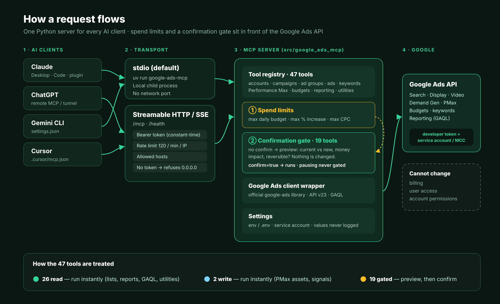
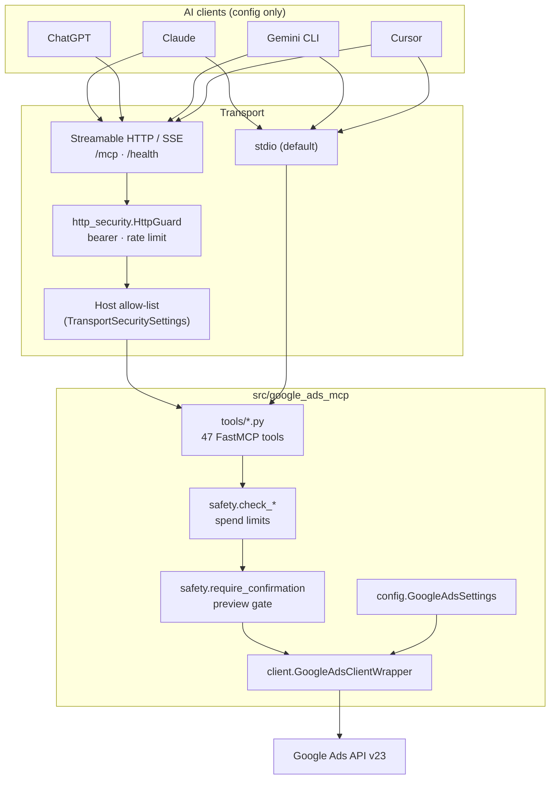
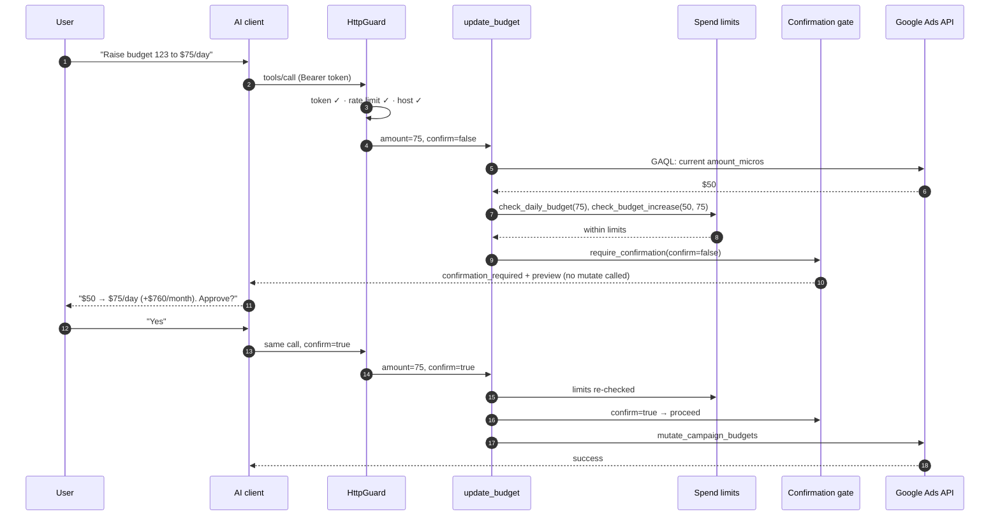
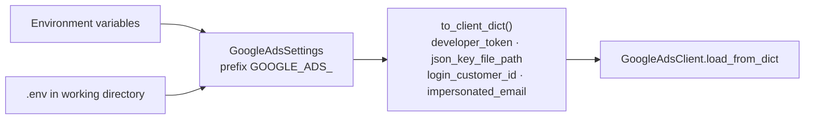
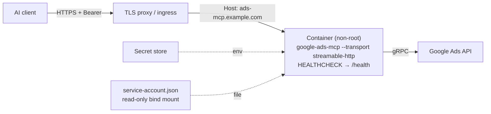

# Architecture

How Google Ads Manager AI Plugin is built: the parts, how a request moves through them, where the safety rules live, and why it is designed this way. For setup and usage, start with the [README](README.md).

<p align="center">
  
</p>

---

## Contents

1. [Design goals](#1-design-goals)
2. [System overview](#2-system-overview)
3. [Components](#3-components)
4. [Request lifecycle](#4-request-lifecycle)
5. [Safety model](#5-safety-model)
6. [Spend limits](#6-spend-limits)
7. [Transports and remote security](#7-transports-and-remote-security)
8. [Credentials](#8-credentials)
9. [Google Ads client](#9-google-ads-client)
10. [Tool annotations](#10-tool-annotations)
11. [Error model](#11-error-model)
12. [The Claude plugin](#12-the-claude-plugin)
13. [Testing](#13-testing)
14. [Deployment](#14-deployment)
15. [Design decisions](#15-design-decisions)
16. [Known limitations](#16-known-limitations)
17. [Adding a tool](#17-adding-a-tool)

---

## 1. Design goals

| Goal | In practice |
|---|---|
| **One implementation** | Every AI client talks to the same Python package, `src/google_ads_mcp/`. Client folders hold launch configs only. |
| **The server enforces safety** | Risky actions are gated in server code, not left to each AI client's approval UI or tool hints. |
| **Stopping is always instant** | Pausing is never gated, so a user can always stop spend immediately. |
| **Limits beat confirmations** | Configured spend limits refuse a request even after the user confirms it. |
| **Secrets stay put** | Credentials come from the environment or mounted files and never appear in logs, errors or `/health`. |
| **Safe to expose** | Remote mode requires a token to bind a public address, with rate limits and host checks. |
| **Works without credentials** | The server starts even if credentials fail, so offline tools stay available and the error is visible. |

---

## 2. System overview



---

## 3. Components

| Path | Responsibility |
|---|---|
| `server.py` | Creates the FastMCP server (with instructions that explain the safety workflow to AI clients), the lifespan that builds the Google Ads client, the `/health` route, the CLI, and HTTP startup through `build_http_app`. |
| `safety.py` | `GATED_TOOLS`, `require_confirmation`, spend-limit checks, status helpers, and best-effort lookups (`lookup_budget_amount`, `lookup_campaign`) used to fill previews. |
| `http_security.py` | `HttpGuard` ASGI middleware (bearer + rate limit), `SlidingWindowRateLimiter`, `build_transport_security` (allowed hosts), `check_startup_safety`. |
| `client.py` | `GoogleAdsClientWrapper`: loads the official client, resolves customer IDs, returns services and types (API v23). |
| `config.py` | `GoogleAdsSettings` (pydantic-settings) reading `GOOGLE_ADS_*` from the environment or `.env`. |
| `helpers.py` | GAQL execution, micros ↔ currency, response builders, Google Ads error extraction. |
| `annotations.py` | MCP `ToolAnnotations` constants (read-only, create, update, destructive). |
| `tools/` | `accounts`, `campaigns`, `ad_groups`, `ads`, `keywords`, `budgets`, `performance_max`, `reporting`, `utilities`. |

---

## 4. Request lifecycle

Example: a user asks to raise a budget. This exercises every layer.



Read tools skip steps 5–10 and go straight to the API.

---

## 5. Safety model

### What is gated

| Tool | Gated when |
|---|---|
| `create_budget` | always |
| `update_budget` | amount or delivery method changes (renaming is instant) |
| `create_campaign` | always (PAUSED by default; ENABLED shows "goes live immediately") |
| `update_campaign` | enabling, removing, bidding targets or dates change (renaming and pausing are instant) |
| `set_campaign_status` | `ENABLED` or `REMOVED` (`PAUSED` is instant) |
| `remove_campaign` | always |
| `create_ad_group` | `ENABLED` or any bid set (`PAUSED` without bids is instant) |
| `update_ad_group` | bids, enabling or removing |
| `set_ad_group_status` | `ENABLED` or `REMOVED` |
| `create_responsive_search_ad`, `create_responsive_display_ad`, `create_video_ad`, `create_demand_gen_ad` | created `ENABLED` |
| `set_ad_status` | `ENABLED` or `REMOVED` |
| `add_keywords` | always (keywords go live immediately in enabled ad groups) |
| `update_keyword_bid` | always |
| `remove_keyword` | always |
| `create_performance_max_campaign` | always |
| `remove_asset_from_group` | always |

`tests/test_safety.py` checks that the set of tools exposing a `confirm` argument is exactly `GATED_TOOLS`, so the list cannot silently drift.

### Preview contents

| Field | Meaning |
|---|---|
| `tool` | The tool that will run |
| `summary` | One-line description |
| `current_state` | What is there now, when it can be read (e.g. current budget, campaign name and status) |
| `requested_changes` | Exactly what will change |
| `financial_impact` | Plain-language money impact (per day, and per month for budgets) |
| `reversible` | `false` for removals |
| `spend_limits` | The limits currently in force |

### Guarantees

- **No API mutation happens without `confirm=True`** on a gated path. Tests assert that no `mutate*` method is called on any Google Ads service for every gated call without confirmation.
- `confirm` must be the boolean `True`; truthy values such as `"yes"` or `1` do not count at the gate.
- Confirmation is per call. There is no session-wide "approve all" switch.
- Removal tools accept `confirm=True`; the older `confirm_removal=True` is kept for compatibility.
- **Regression fixed:** `set_campaign_status(status="REMOVED")` previously skipped the removal confirmation required by `remove_campaign`. It is now gated.

---

## 6. Spend limits

| Variable | Checked by | Rule |
|---|---|---|
| `GOOGLE_ADS_MAX_DAILY_BUDGET` | `create_budget`, `update_budget`, `create_campaign`, `create_performance_max_campaign` | Daily amount must not exceed the limit |
| `GOOGLE_ADS_MAX_BUDGET_INCREASE_PCT` | `update_budget` | Increase over the current amount must not exceed the limit. If the current amount cannot be read, the change is refused. Decreases are always allowed. |
| `GOOGLE_ADS_MAX_CPC_BID` | `create_ad_group`, `update_ad_group`, `add_keywords`, `update_keyword_bid` | Max-CPC bid must not exceed the limit |

- Limits run **before** the confirmation gate and again on the confirmed call, so a request over a limit is refused even with `confirm=True`.
- Unset, zero, negative or non-numeric values mean "no limit" (with a warning in the log).
- Limits are read on every call, so changing them needs no restart.
- A refusal returns `blocked_by_spend_limit: true` with the requested value and the limit.

---

## 7. Transports and remote security

| | stdio | Streamable HTTP / SSE |
|---|---|---|
| Start | `google-ads-mcp` | `google-ads-mcp --transport streamable-http --host … --port …` |
| Clients | Claude Desktop, Cursor, Gemini CLI | ChatGPT, remote connectors, hosted setups |
| Network | none | `/mcp` (or SSE paths) and `/health` |
| Login | OS process boundary | `MCP_HTTP_BEARER_TOKEN`, SHA-256 + `hmac.compare_digest` |
| Rate limit | n/a | Sliding window per client IP, `MCP_RATE_LIMIT_MAX` / `MCP_RATE_LIMIT_WINDOW_SECONDS` (120/60 s), idle keys evicted |
| Host check | n/a | Loopback names when bound locally; `MCP_ALLOWED_HOSTS` for public domains (DNS-rebinding protection) |
| Start-up rule | — | Refuses a non-local bind without a bearer token unless `MCP_ALLOW_UNAUTHENTICATED=true` |

`/health` is exempt from login and rate limiting. It returns status, version, whether credentials are configured (booleans only), whether login is on, the number of gated tools and the spend limits.

HTTP startup builds the app with `build_http_app()`: set transport security → create the FastMCP Starlette app → wrap it in `HttpGuard` → run with uvicorn.

---

## 8. Credentials



- Required: developer token and service-account JSON path. Optional: MCC login customer ID, default customer ID, Workspace impersonation email.
- Customer IDs may contain dashes; they are stripped.
- If loading fails, the error is logged (paths only, never values) and the server runs without API access.

---

## 9. Google Ads client

- Official `google-ads` Python library, API **v23**, proto-plus enabled.
- Reads use GAQL through `GoogleAdsService.search` (or `search_stream`), converted to plain dicts.
- Writes use the typed services (`CampaignBudgetService`, `CampaignService`, `AdGroupService`, `AdGroupAdService`, `AdGroupCriterionService`) or `GoogleAdsService.mutate` for multi-resource atomic creates (campaign + budget, Performance Max) with temporary negative IDs.
- Money is converted between currency and micros (1,000,000 micros = 1 unit).

---

## 10. Tool annotations

Every tool carries an MCP `ToolAnnotations` hint (`READ_ONLY`, `READ_ONLY_LOCAL`, `CREATE`, `UPDATE`, `DESTRUCTIVE`). Clients may use these to decide when to ask for approval. They are **hints only**; the confirmation gate is what actually enforces safety on the server.

---

## 11. Error model

| Response | When |
|---|---|
| `{"success": true, "data": …}` | The action ran |
| `{"success": false, "confirmation_required": true, "preview": …}` | Gated action without `confirm=true`; nothing changed |
| `{"success": false, "blocked_by_spend_limit": true, "error": …, "details": …}` | A spend limit refused the request |
| `{"success": false, "error": …}` | Validation problem or a Google Ads API error (messages extracted from `GoogleAdsException`) |
| HTTP `401` / `429` / `421` | Missing or wrong token / rate limit / disallowed `Host` (remote only) |

Tool errors are returned as data, not raised, so an AI client can read them and recover.

---

## 12. The Claude plugin

```text
google-ads-manager/
├── .claude-plugin/plugin.json      plugin metadata
├── .mcp.json                       launches `uv run --directory .. google-ads-mcp`
├── commands/google-ads-setup.md    /google-ads-setup
└── skills/google-ads-manager/SKILL.md
```

The skill tells Claude to show each preview in plain language, only confirm after explicit approval, pause immediately when asked, and never work around a spend limit. The plugin holds metadata only; all logic lives in `src/google_ads_mcp/`.

---

## 13. Testing

| File | Covers |
|---|---|
| `tests/test_safety.py` | Gate behaviour, strict `confirm`, risky statuses, every spend limit, `GATED_TOOLS` ↔ registry consistency |
| `tests/test_tools/test_gated_tools.py` | Every gated call: preview without `confirm` and no mutate; API reached with `confirm=True`; pausing and renaming never gated; legacy `confirm_removal`; the `REMOVED` regression; limits blocking confirmed calls |
| `tests/test_http_security.py` | Token comparison, start-up rule, allowed hosts, rate limiter and eviction, middleware 401/429, real app `/health`, auth and `Host` rejection |
| `tests/test_annotations.py` | Every tool has the expected annotation |
| `tests/test_gaql_fields.py`, `test_helpers.py`, `test_config.py`, `test_server_cli.py` | GAQL field validity, helpers, settings, CLI and transport selection, client config files, Docker files |

253 tests run in about a second with the Google Ads API fully mocked. CI runs them on Python 3.12 and 3.13 and builds the Docker image.

---

## 14. Deployment



Checklist:

- [ ] HTTPS in front of the container
- [ ] `MCP_HTTP_BEARER_TOKEN` (long, random) and `MCP_ALLOWED_HOSTS` set
- [ ] Spend limits set (`GOOGLE_ADS_MAX_*`)
- [ ] Key file mounted read-only, never baked into the image
- [ ] Client-side approval for write tools also enabled where the client supports it

---

## 15. Design decisions

| Decision | Why |
|---|---|
| Gate in server code, not only annotations | Annotations are hints that clients may ignore; the server is the one place every request passes through. |
| Two-call preview/confirm | Works in every MCP client today without client-specific UI. |
| Never gate pausing | The safest action must never be slowed down. |
| Limits checked before and after confirmation | A confirmed typo is still a typo. |
| Refuse unknown current budget when an increase limit is set | Failing closed is safer than guessing. |
| Refuse public bind without a token | An open Google Ads controller on the internet is never the intended setup. |
| Keep `confirm_removal` | Existing prompts and integrations keep working. |
| Keep Python and the official library | Mature coverage of the Google Ads API, including Performance Max. |

---

## 16. Known limitations

- `execute_gaql` can read any resource the credentials can, including user-access data.
- The rate limiter is in memory, so limits apply per process/container.
- Bearer login is a single shared token; there are no per-user identities or audit log yet.
- Spend limits are per request; there is no account-wide daily spend cap.
- Previews for campaign changes depend on a GAQL lookup; if it fails, the preview shows less context (the gate still applies).
- `add_assets_to_group` and `add_audience_signal` are not gated, because they do not directly start or raise spend.

---

## 17. Adding a tool

1. Add the function in the right `tools/*.py` file with `@mcp.tool(annotations=…)` and a clear docstring.
2. If it can start spend, raise spend, enable or remove something:
   - add `confirm: bool = False`;
   - call the relevant `check_*` limit functions first;
   - call `require_confirmation(...)` before any API call, with an honest `financial_impact` and `reversible`;
   - add the name to `GATED_TOOLS`.
3. Never gate a pause.
4. Add the annotation to `tests/test_annotations.py`, and gated and ungated cases to `tests/test_tools/test_gated_tools.py`.
5. Regenerate the table in `docs/tools.md` and update the README tool table and `CHANGELOG.md`.
